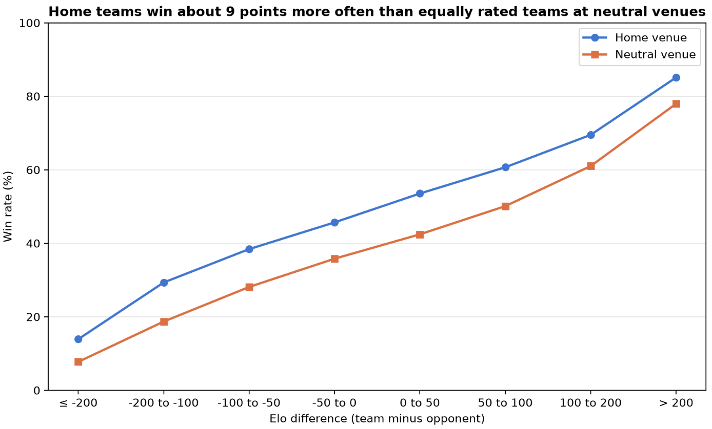
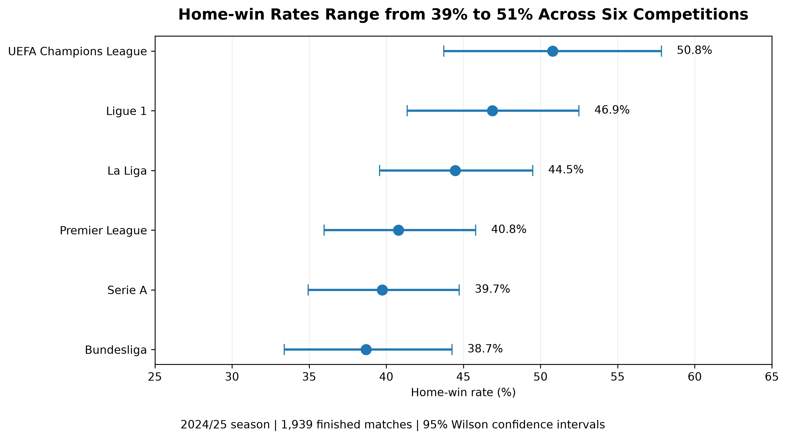
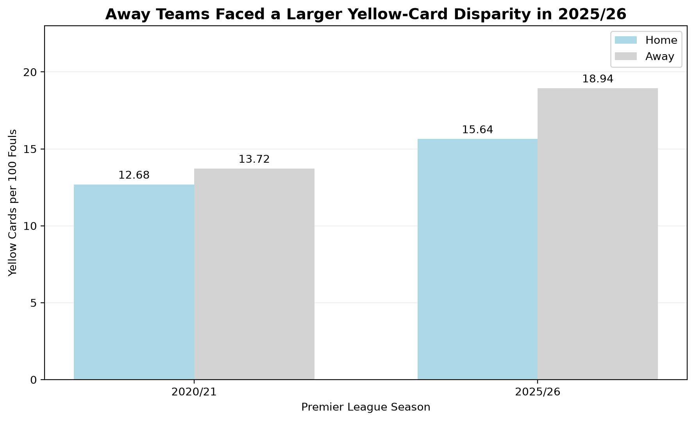

# cs418-football
## Research Question
Home-Field Advantage in Soccer - How does playing at home affect team performance and match outcomes? 

## Group Members: Youssef Elghawabi, Dominic Aidoo, Nate Rodriguez, Zonghong Lu, Hannan Shahid

### Primary dataset 1: International football results (Hannan)
I got this dataset from: (https://github.com/martj42/international_results/blob/master/results.csv). The file is 'results.csv', and it's loaded in 'International_matches.ipynb'.

I picked this dataset because it shows the home, away, and neutral international games, and I found the neutral column to be important because it gives us extra information to look at. It also gives us a no home advantage baseline to compare real home games against, which the Premier League dataset can't do since every league game has a home team.

What's in it:

- 49,547 rows and 9 columns, and each row is a men’s international match.
- It covers 30 Nov 1872 to 26 Aug 2026 worldwide (national teams).
- 36,389 matches were played at home and 13,158 at a neutral venue.
- No missing values in any columns.
- Extra time scores are included but not penalty shootouts.
- Only the results are recorded, no attendance. 
- Columns being used: ‘date’(date), ‘home_team’, ‘away_team’, ‘tournament’, ‘city’,‘country’ (strings) , ‘home_score’ and ‘away_score’(ints), ‘neutral’(boolean).

Quick look: Home teams averaged 1.76 goals vs 1.18 away. At home venues the home team won 50.7%, and at neutral venues the team listed won 44.2%, a gap of about 6.5 points.

**Data documentation:** [martj42/international_results](https://github.com/martj42/international_results), CC0 1.0 (public domain). Full details are in [DATASHEET.md](DATASHEET.md).

### Primary dataset 2: Top 5 leagues & Champions League Football Matches 2024/2025 (Youssef)

I got this dataset from GitHub ([https://github.com/tarekmasryo/football-matches-2025-dataset](https://github.com/tarekmasryo/football-matches-2025-dataset)). The data was originally collected through the Football-Data.org API. The file is `football_matches_2024_2025.csv`, and it is loaded in `football_matches_2024_2025.ipynb`.

I picked this dataset because it contains match-level home and away results across multiple major European leagues and the UEFA Champions League, which allows us to compare home-field advantage across different competitions.

What's in it:

- 1,941 rows and 23 columns, and each row represents one football match.
- It covers the 2024/2025 season from August 15, 2024 through May 31, 2025.
- It includes six competitions: Premier League, La Liga, Serie A, Bundesliga, Ligue 1, and UEFA Champions League.
- Geographically, the domestic leagues cover England, Spain, Italy, Germany, and France, while the Champions League includes clubs from across Europe.
- Columns I'm using: `competition_name`, `date_utc`, `home_team`, `away_team`, `fulltime_home`, `fulltime_away`, `match_outcome`, `home_points`, `away_points`, and `stage`.
- `competition_name`, `date_utc`, `home_team`, `away_team`, `match_outcome`, and `stage` are read in as strings/objects. `fulltime_home`, `fulltime_away`, `home_points`, and `away_points` are integers.
- There are no missing values in the 23 columns.
- The dataset contains 380 Premier League matches, 380 La Liga matches, 380 Serie A matches, 306 Bundesliga matches, 306 Ligue 1 matches, and 189 UEFA Champions League matches.
- Because the dataset includes both the home and away teams, their scores, and the match outcome, we can use it to compare home and away win rates across different competitions.

### Secondary dataset 1: Historical Premier League team performance (Nate)

I got this dataset from Kaggle (https://www.kaggle.com/datasets/alibakikoyuncu/tm-epl-9293-ranking?resource=download). The file is `epl_data.csv`, and it's loaded in `data_acquisition.ipynb`.

I picked it because it contains separate home and away performance statistics for Premier League teams across many seasons, so it's useful for comparing how teams perform at home vs away over time.

What's in it:
- 666 rows and 18 columns, one row represents one Premier League team's performance during one season
- covers Premier League seasons from 1992 through 2024
- columns I'm using: `season`, `team_name`, `home_matches_ranking`, `away_matches_ranking`, `home_matches_win`, `home_matches_draw`, `home_matches_lost`, `away_matches_win`, `away_matches_draw`, `away_matches_lost`, and `home_matches_pts`
- `team_name` is a string, while `season`, rankings, wins, draws, losses, points, and other match statistics are integers
- `average_age` is stored as a float
- there are no missing values in any of the 18 columns
- unlike the match-level dataset, this dataset summarizes each team's performance for an entire season rather than individual matches
- because it includes separate home and away records, we can use it to compare team performance at home vs away and examine home-field advantage across multiple Premier League seasons

### Secondary dataset 2: 2020/2021 Premier League Season Stats (Dominic)

I got this dataset from 'https://football-data.co.uk/englandm.php'. The data file is 'epl_2020.csv' and it is loaded in 'epl_2020.ipynb'. 

I chose this dataset because it represents the season in the premier league where there were no fans in the stadium because of the COVID pandemic. It will be interesting to compare the results from this season to recent seasons where they have been fans in the stadium. 

What's in it:
- 380 columns
- 106 rows
- Includes every single game from the 2020/2021 season including their results, goals, shots taken, shots on target, etc.
- Kept 9 of the columns as the rest seemed irrelevant

### Secondary dataset 3: Premier League matches 2025/26 (Lu)

I got this from football-data.co.uk (https://www.football-data.co.uk/englandm.php). The file is 'E0.csv', and the column names are explained here: https://www.football-data.co.uk/notes.txt. It's loaded in ‘data_acquisition.ipynb’.

I picked it because each row has both the home and away team's stats for the same game, so it's easy to compare home vs away.

What's in it:
- 380 rows and 132 columns, one row is one match
- the whole 2025/26 season, 20 teams, each plays 19 home and 19 away
- most of the 132 columns are betting odds, only kept 19 for now
- columns I'm using: `Date` (read in as a string, I converted it to a date), ‘HomeTeam’, ‘Away’, ‘Referee’, and ‘FTR’ (H/D/A result) are strings. Goals (‘FTHG‘/’FTAG’), shots (‘HS’/‘AS’), shots on target (‘HST’/‘AST’), corners (‘HC’/‘AC’), fouls (‘HF’/‘AF’), yellow cards (‘HY’/‘AY’) and red cards (‘HR’/‘AR’) are all ints
- no missing values in any of those
- it doesn't have possession, xG or attendance, so we'd need another source for those

Quick look: home teams won 42.6% of games vs 30.0% for away teams (27.4% draws). Home teams also scored more (1.53 vs 1.22 goals) and took more shots (13.8 vs 11.2). They got fewer yellow cards (1.67 vs 2.08) even though fouls were about the same (10.7 vs 11.0). This is just one season so I can't say much yet.

### Exploratory Analysis

## Basics About the Datasets

Our analysis uses two primary datasets and three secondary datasets to investigate home-field advantage in soccer. The primary datasets include 49,547 international football matches from 1872–2026 and 1,941 European football matches from the 2024/25 season across six competitions. The secondary datasets cover historical Premier League team performance, the 2020/21 Premier League season, and the 2025/26 Premier League season.

## Revised Research Questions

Our original research question was: How does playing at home affect team performance and match outcomes?

Based on our exploratory analysis, we proposed these revised questions:

How does home-field advantage vary across European football competitions when comparing home-win, away-win, and draw percentages?

How much does playing at home increase a team's chance of winning compared to a neutral venue, and does this advantage change with match importance over time?

Does home advantage shrink or disappear without fans, and does it come back when they return?

## Anomalies

| Anomaly | Rows affected | Action |

| Awarded matches in 2024/25 dataset | 2 | Excluded from analysis |
| `date_utc` stored as an object | 1,939 | Converted to datetime |
| Unknown referee information | 3 | Kept and flagged |
| International matches sharing dates and teams but having different scores | 2 | Noted as potentially separate matches |
| International home-country mismatches | 979 | Used neutral column to distinguish venue types |
| Incomplete 2024 season in historical EPL data | 20 | Excluded; used full 2024/25 dataset instead |
| Different season and match-result formats | All relevant rows | Standardized season and outcome formats |
| Behind-closed-doors matches within 2019/20 | 92 | Flagged |

## Significant Findings

In the 2024/25 European dataset, home teams won 832 matches, compared to 644 away wins and 463 draws. Home teams averaged 1.54 goals per match, compared to 1.34 for away teams.

Home-win percentages differed across European competitions. The Champions League had the highest home-win percentage at 50.79%, while the Bundesliga had the lowest at 38.69%.

## Data Documentation

Full documentation of our datasets, including their scope, codebooks, cleaning steps, and limitations, is available in [DATASHEET.md](DATASHEET.md).

| Dataset | Source | License / Terms |
|---|---|---|
| International Football Results (Hannan) | [GitHub](https://github.com/martj42/international_results) | CC0 1.0 (Public Domain) |
| European Football 2024/25 (Youssef) | [GitHub](https://github.com/tarekmasryo/football-matches-2025-dataset) | CC BY 4.0; original data subject to Football-Data.org terms |
| Historical Premier League (Nate) | [Kaggle](https://www.kaggle.com/datasets/alibakikoyuncu/tm-epl-9293-ranking) | License not verified, but Kaggle Terms of Use apply. |
| Premier League 2020/21 (Dominic) | [Football-Data.co.uk](https://www.football-data.co.uk/englandm.php) | Free for quantitative analysis and educational use |
| Premier League 2025/26 (Lu) | [Football-Data.co.uk](https://www.football-data.co.uk/englandm.php) | No formal license; fair data usage policy for personal and academic use; commercial and data-training use restricted |

**Biggest Limitation:** Our datasets cover different competitions and seasons, and some lack information such as stadium attendance and team strength. Therefore, we can compare patterns in home-field advantage, but we cannot determine exactly what causes those differences or generalize them to all football matches.

### Finding 1: Playing at Home Adds About 9 Points to a Team's Win Rate

I compared 36,389 home venue international matches with around 13,000 neutral venue ones. In those, home teams won 50.7 percent of the time, and the first listed team at a neutral venue won 44.2 percent of the time. This is a 6.5 point gap, since stronger teams could just be ending up in one group, I built a pre match 'Elo' like ratings from past results and controlled for them in a logistic regression with around 45,000 matches. After that, playing at home was worth about +9.0 points. Then I tried to see how this holds up by first splitting the matches into 8 strength bands, and home teams still won more in every band, by 6 to 11 points. I also checked whether the effect changes for competitive vs friendly games or over time. Neither finding was significant, so no evidence was found that it changes. Overall this shows that playing at home is linked to winning more though it doesn't tell us why because there is no attendance or travel data.

### Finding 2: Home-Win Rates Vary Across European Competitions

Home-win rates differed significantly across Europe's five major domestic leagues and the UEFA Champions League during the 2024/25 season (chi-square test, p = 0.0404). The Champions League had the highest home-win rate at 50.79% (95% CI: 43.72%–57.83%), while the Bundesliga had the lowest at 38.69% (95% CI: 33.40%–44.26%). However, when we excluded the Champions League, the differences among the five domestic leagues were not statistically significant (p = 0.1753). As a robustness check, we repeated the test using all three match outcomes—home wins, away wins, and draws—and found a similar pattern: significant variation across all six competitions (p = 0.0105), but not among the five domestic leagues alone (p = 0.2240). One possible explanation is that the Champions League has a different competition format and team matchups, which may influence match outcomes. These results do not establish that competition format caused the differences or that home advantage is identical across domestic leagues.

## Finding 4 - Away Teams Faced a Larger Yellow-Card Disparity in 2025/26

Away teams received more yellow cards per 100 fouls than home teams in both Premier League seasons, but the difference was larger in 2025/26 than in 2020/21. During the largely fan-free 2020/21 season, home teams received 12.68 yellow cards per 100 fouls compared with 13.72 for away teams, a difference of 1.03 (two-proportion z-test, p = 0.1645). In 2025/26, home teams received 15.64 compared with 18.94 for away teams, a difference of 3.30 (p = 0.0000752). The away-home gap increased by 2.27 cards per 100 fouls, with a 95% match-level bootstrap confidence interval of 0.31 to 4.26. To check whether a few teams were driving the difference, we compared rates across clubs and found that 17 out of 20 teams had higher away rates in 2025/26, compared with 11 of 20 in 2020/21. Although these findings suggest a stronger home-away disciplinary disparity in 2025/26, differences in foul severity, team composition, and other factors may explain this pattern. Therefore, the results do not establish that crowd presence caused the difference.

